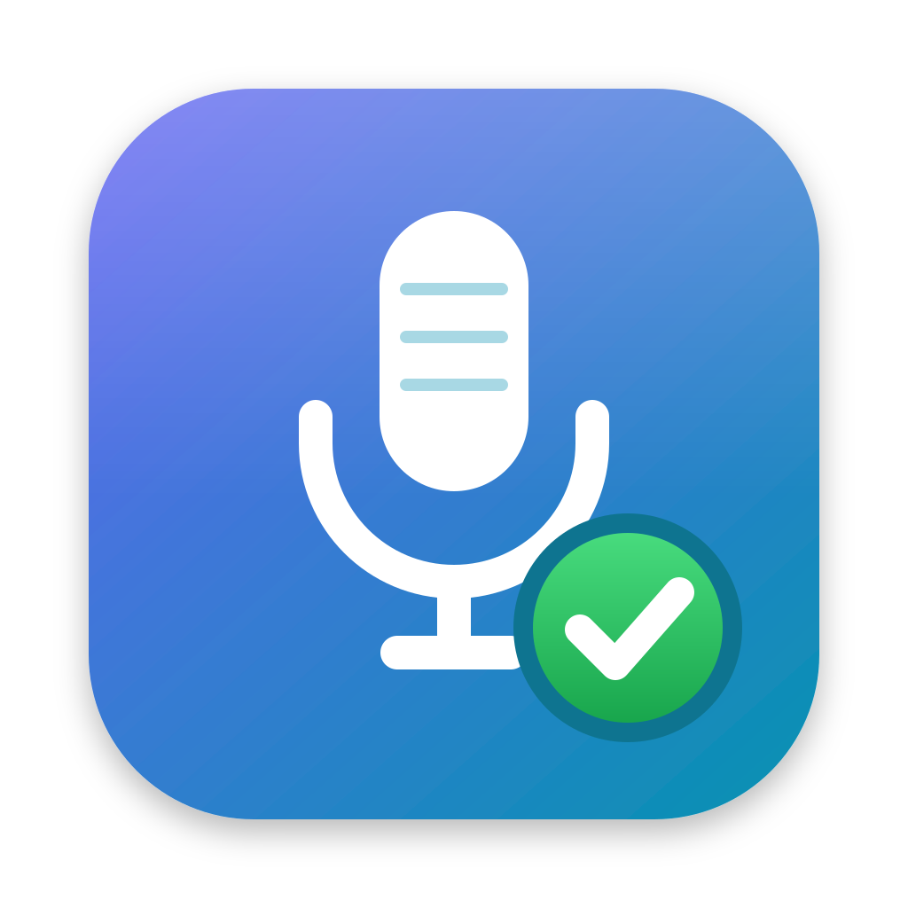

<p align="center">
  
</p>

<h1 align="center">MicKeeper</h1>

<p align="center">
  Keeps the Mac's default microphone off Bluetooth devices, preserving audio quality.
</p>

<p align="center">
  <b>English</b> · <a href="README.md">Português (BR)</a>
</p>

<p align="center">
  <a href="https://github.com/wac0013/mickeeper/actions/workflows/ci.yml"></a>
  <a href="https://github.com/wac0013/mickeeper/actions/workflows/release.yml"></a>
  <a href="https://github.com/wac0013/mickeeper/releases/latest"></a>
  <a href="https://github.com/wac0013/mickeeper/releases"></a>
  <a href="https://github.com/wac0013/homebrew-tap"></a>
</p>
<p align="center">
  
  
  
  
  
  
</p>
<p align="center">
  <a href="LICENSE"></a>
  
  <a href="https://github.com/wac0013/mickeeper/commits/main"></a>
  <a href="https://github.com/wac0013/mickeeper/issues"></a>
  
</p>

---

The problem: when AirPods or a headset connect, macOS may switch the default microphone to the Bluetooth device. That forces the low-quality HFP profile and degrades the audio, output included.

## Install

```bash
brew install wac0013/tap/mickeeper
```

Requires macOS 13+ (Intel and Apple Silicon). The app is ad-hoc signed (not notarized); the cask clears the quarantine flag on install.

Upgrade: `brew update && brew upgrade --cask mickeeper`

Manual install: download the `.zip` from [Releases](https://github.com/wac0013/mickeeper/releases), move it to `/Applications` and run `xattr -dr com.apple.quarantine /Applications/MicKeeper.app`.

## How it works

It listens to CoreAudio for changes to the default input and to the device list (no polling, no timers). When the input becomes a device that isn't allowed, it switches back to one that is:

1. **Ranking** (optional): the first connected device in the ranking.
2. The current input, if allowed (manually switching to a USB mic, for example, makes it the new "last good" device).
3. The **last good** device, if connected.
4. The built-in microphone.

Permission rules:

- **Blocked** devices can never be the default input (blocking wins over the ranking).
- **Bluetooth** is blocked by default. It is only allowed when the **ranking is on** and the device is in it (a Bluetooth mic you chose on purpose).
- With the ranking on, it is strict: if a higher-ranked device connects, the input moves to it.
- The audio output is never changed.

## Menu

- State (protected/paused) and current microphone; `mic.fill` (active) / `mic.slash` (paused) icon
- **Protection on** (⌘E) — turning it off removes the listeners (zero cost)
- **Input devices** → use now / always block / add to ranking
- **Ranking** → use ranking, order (up/down), remove
- **Blocked** → unblock
- **Launch at login** (via `SMAppService`; if approval is needed, it opens System Settings)
- **Show menu bar icon** — to bring back a hidden icon, open the app again (`open -a MicKeeper`)

The interface follows the system language: Brazilian Portuguese if the system is in Portuguese, English otherwise.

## Privacy

- No network, no telemetry, no auto-update.
- It doesn't capture audio or ask for microphone permission: it only reads and sets the default device.
- Settings live in local `UserDefaults` (`io.github.wac0013.mickeeper`): state, ranking, blocklist and the UID of the last good device. Device names are never logged or sent anywhere.

## Development

```bash
swift test              # policy, config and strings (macOS)
scripts/bundle.sh       # builds build/MicKeeper.app and the .zip
```

Icon: `assets/icon.svg` is the source. To regenerate `Resources/AppIcon.icns` (any OS): `npm i --no-save @resvg/resvg-js && node scripts/make-icon.mjs`.

Developing on Linux (remote build on a Mac over restricted SSH): see [scripts/remote](scripts/remote). On the Mac: `scripts/remote/mac-setup.sh "<public key>" "<server IP>"`; on the server: `scripts/remote/mac.sh test|bundle`.

Release: `git tag vX.Y.Z && git push --tags` → the workflow tests, publishes the `.zip` and updates the cask in [`wac0013/homebrew-tap`](https://github.com/wac0013/homebrew-tap) (needs the `TAP_TOKEN` secret).

## License

[MIT](LICENSE)
