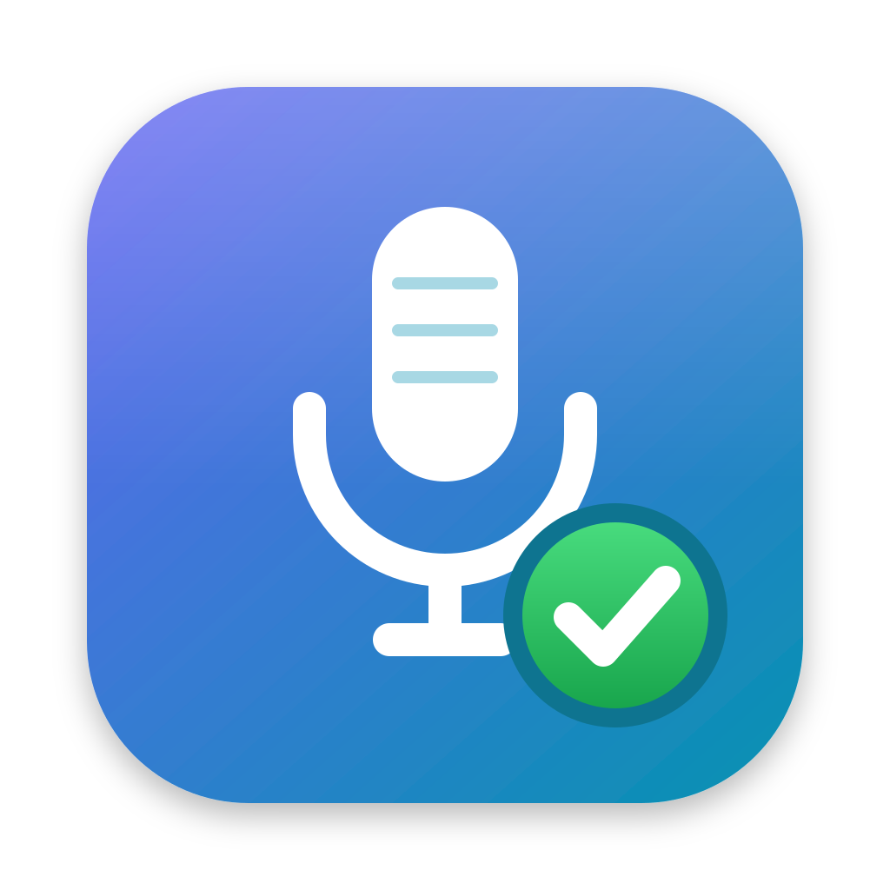

<p align="center">
  
</p>

<h1 align="center">MicKeeper</h1>

<p align="center">
  Mantém o microfone padrão do Mac fora de dispositivos Bluetooth, preservando a qualidade do áudio.<br>
  <em>Keeps the Mac's default microphone off Bluetooth devices, preserving audio quality.</em>
</p>

<p align="center">
  <a href="README.en.md">English</a> · <b>Português (BR)</b>
</p>

<p align="center">
  <a href="https://github.com/wac0013/mickeeper/actions/workflows/ci.yml"></a>
  <a href="https://github.com/wac0013/mickeeper/actions/workflows/release.yml"></a>
  <a href="https://github.com/wac0013/mickeeper/releases/latest"></a>
  <a href="https://github.com/wac0013/mickeeper/releases"></a>
  <a href="https://github.com/wac0013/homebrew-tap"></a>
</p>
<p align="center">
  
  
  
  
  
  
</p>
<p align="center">
  <a href="LICENSE"></a>
  
  <a href="https://github.com/wac0013/mickeeper/commits/main"></a>
  <a href="https://github.com/wac0013/mickeeper/issues"></a>
  
</p>

---

O problema: ao conectar AirPods ou um headset, o macOS pode trocar o microfone padrão para o Bluetooth. Isso força o perfil HFP e derruba a qualidade do áudio, inclusive da saída.

*The problem: when AirPods or a headset connect, macOS may switch the default microphone to the Bluetooth device. That forces the low-quality HFP profile and degrades output audio too.*

## Instalação / Install

```bash
brew install wac0013/tap/mickeeper
```

Requer macOS 13+ (Intel e Apple Silicon). O app tem assinatura ad-hoc (sem notarização); o cask remove a quarentena na instalação. / Requires macOS 13+. The app is ad-hoc signed (not notarized); the cask clears the quarantine flag on install.

Atualizar / upgrade: `brew update && brew upgrade --cask mickeeper`

Instalação manual: baixe o `.zip` em [Releases](https://github.com/wac0013/mickeeper/releases), mova para `/Applications` e rode `xattr -dr com.apple.quarantine /Applications/MicKeeper.app`.

## Como funciona

Escuta, via CoreAudio, mudanças da entrada padrão e da lista de dispositivos (sem polling, sem timers). Quando a entrada vira um dispositivo não permitido, volta para um permitido:

1. **Ranking** (opcional): o primeiro dispositivo do ranking que estiver conectado.
2. A entrada atual, se permitida (trocar manualmente para um USB, por exemplo, vira o novo "último bom").
3. O **último bom** conectado.
4. O microfone embutido.

Regras de permissão:

- **Bloqueados** nunca podem ser a entrada padrão (vence o ranking).
- **Bluetooth** é bloqueado por padrão. Só é permitido se o **ranking estiver ligado** e o dispositivo estiver nele (um microfone Bluetooth escolhido de propósito).
- Com o ranking ligado, ele é estrito: se um dispositivo melhor do ranking conectar, a entrada vai para ele.
- A saída de áudio nunca é alterada.

## Menu

- Estado (protegido/pausado) e microfone atual; ícone `mic.fill` (ativo) / `mic.slash` (pausado)
- **Proteção ativa** (⌘E) — desligar remove os listeners (custo zero)
- **Dispositivos de entrada** → usar agora / bloquear sempre / incluir no ranking
- **Ranking** → usar ranking, ordem (subir/descer), remover
- **Bloqueados** → desbloquear
- **Iniciar com o sistema** (via `SMAppService`; se pedir aprovação, abre os Ajustes)
- **Mostrar ícone na barra** — para reexibir um ícone oculto, abra o app de novo (`open -a MicKeeper`)

A interface segue o idioma do sistema: PT-BR se português, inglês caso contrário.

## Privacidade

- Sem rede, sem telemetria, sem auto-update.
- Não captura áudio nem pede permissão de microfone: só lê e define o dispositivo padrão.
- A configuração fica em `UserDefaults` local (`io.github.wac0013.mickeeper`): estado, ranking, bloqueados e UID do último dispositivo bom. Nomes de dispositivos não são logados nem enviados.

## Desenvolvimento

```bash
swift test              # política, config e textos (macOS)
scripts/bundle.sh       # gera build/MicKeeper.app e o .zip
```

Ícone: `assets/icon.svg` é a fonte. Para regenerar o `Resources/AppIcon.icns` (qualquer SO): `npm i --no-save @resvg/resvg-js && node scripts/make-icon.mjs`.

Dev em Linux (build remoto no Mac via SSH restrito): veja [scripts/remote](scripts/remote). No Mac: `scripts/remote/mac-setup.sh "<chave pública>" "<IP do servidor>"`; no servidor: `scripts/remote/mac.sh test|bundle`.

Release: `git tag vX.Y.Z && git push --tags` → o workflow testa, publica o `.zip` e atualiza o cask em [`wac0013/homebrew-tap`](https://github.com/wac0013/homebrew-tap) (requer o secret `TAP_TOKEN`).

## Licença

[MIT](LICENSE)
